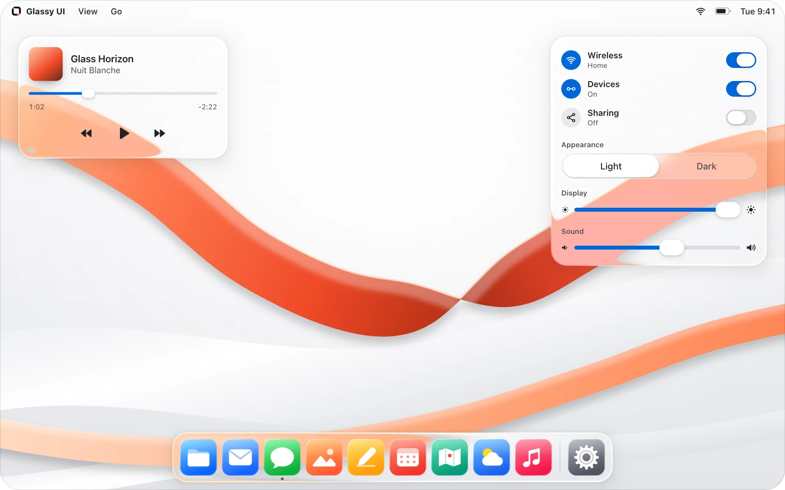
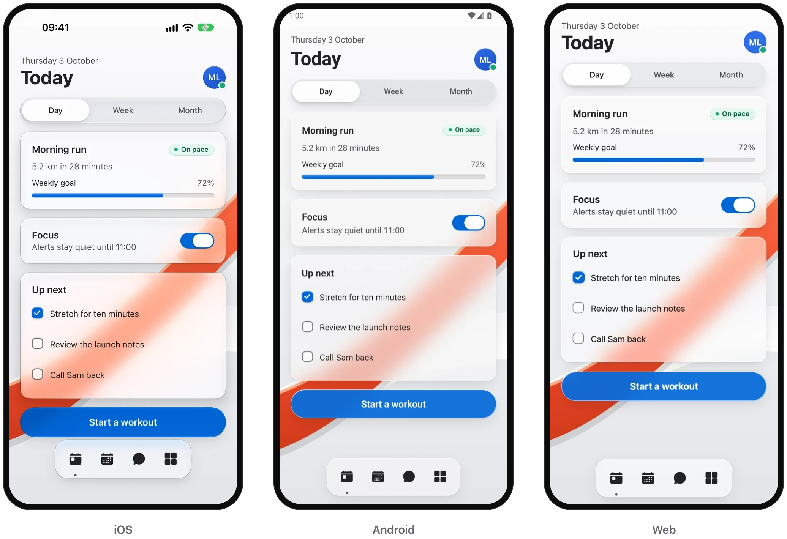

<p align="center">
  <picture>
    <source media="(prefers-color-scheme: dark)" srcset=".github/readme/lockup-dark.png">
    
  </picture>
</p>

<p align="center">
  Glass components for React and React Native.<br>
  Add them with the shadcn CLI and own the source.
</p>

<p align="center">
  <a href="https://glassyui.com/docs">Docs</a> &nbsp;·&nbsp;
  <a href="https://glassyui.com/components">Components</a> &nbsp;·&nbsp;
  <a href="https://glassyui.com/guides">Guides</a> &nbsp;·&nbsp;
  <a href="https://glassyui.com/mobile">React Native</a> &nbsp;·&nbsp;
  <a href="https://pro.glassyui.com">Templates</a>
</p>

<br>

<picture>
  <source media="(prefers-color-scheme: dark)" srcset=".github/readme/desk-dark.webp">
  
</picture>

<br>

## Quick start

Glassy UI needs React 19 and Tailwind CSS 4. If your app has no
`components.json`, set up shadcn first:

```bash
npx shadcn@4.14.1 init
```

Add a component. Glassy UI is in the
[shadcn registry directory](https://ui.shadcn.com/docs/directory), so the CLI
finds `@glassyui` with no setup:

```bash
npx shadcn@4.14.1 add @glassyui/glass-button
```

The CLI copies the component, the shared files it imports and its package
dependencies into your app. There is no Glassy UI runtime package.

```tsx
import { GlassButton } from '@/components/glassyui/glass-button';

export function SaveButton() {
  return <GlassButton variant="prominent">Save changes</GlassButton>;
}
```

Set `data-lg-theme="light"` or `data-lg-theme="dark"` on the root element and
keep it in sync with your theme switch. Every
[component page](https://glassyui.com/components) also has pnpm, Yarn and bun
commands, and a manual install that lists every file.

## Components

| Group      | Components                                                                                                                                                                                                                                                                                                                                                                                                                                                                                                                                                           |
| :--------- | :------------------------------------------------------------------------------------------------------------------------------------------------------------------------------------------------------------------------------------------------------------------------------------------------------------------------------------------------------------------------------------------------------------------------------------------------------------------------------------------------------------------------------------------------------------------- |
| Core       | [Provider](https://glassyui.com/components/glass-provider)                                                                                                                                                                                                                                                                                                                                                                                                                                                                                                           |
| Surfaces   | [Surface](https://glassyui.com/components/glass-surface) · [Panel](https://glassyui.com/components/glass-panel) · [Avatar](https://glassyui.com/components/glass-avatar) · [Kbd](https://glassyui.com/components/glass-kbd) · [Scroll Area](https://glassyui.com/components/glass-scroll-area)                                                                                                                                                                                                                                                                       |
| Controls   | [Button](https://glassyui.com/components/glass-button) · [Input](https://glassyui.com/components/glass-input) · [Checkbox](https://glassyui.com/components/glass-checkbox) · [Radio Group](https://glassyui.com/components/glass-radio-group) · [Textarea](https://glassyui.com/components/glass-textarea) · [Select](https://glassyui.com/components/glass-select) · [Switch](https://glassyui.com/components/glass-switch) · [Slider](https://glassyui.com/components/glass-slider) · [Segmented Control](https://glassyui.com/components/glass-segmented-control) |
| Overlays   | [Dialog](https://glassyui.com/components/glass-dialog) · [Popover](https://glassyui.com/components/glass-popover) · [Sheet](https://glassyui.com/components/glass-sheet) · [Menu](https://glassyui.com/components/glass-menu) · [Command](https://glassyui.com/components/glass-command)                                                                                                                                                                                                                                                                             |
| Navigation | [Header](https://glassyui.com/components/glass-header) · [Tabs](https://glassyui.com/components/glass-tabs) · [Accordion](https://glassyui.com/components/glass-accordion) · [Dock](https://glassyui.com/components/glass-dock) · [Breadcrumb](https://glassyui.com/components/glass-breadcrumb) · [Pagination](https://glassyui.com/components/glass-pagination)                                                                                                                                                                                                    |
| Feedback   | [Tooltip](https://glassyui.com/components/glass-tooltip) · [Toast](https://glassyui.com/components/glass-toast) · [Badge](https://glassyui.com/components/glass-badge) · [Progress](https://glassyui.com/components/glass-progress) · [Spinner](https://glassyui.com/components/glass-spinner) · [Skeleton](https://glassyui.com/components/glass-skeleton) · [Alert](https://glassyui.com/components/glass-alert)                                                                                                                                                   |
| Effects    | [Lens](https://glassyui.com/components/glass-lens) · [Scene](https://glassyui.com/components/glass-scene) · [Logo Reveal](https://glassyui.com/components/glass-logo-reveal)                                                                                                                                                                                                                                                                                                                                                                                         |
| Mockups    | [Laptop](https://glassyui.com/components/glass-laptop) · [Phone Duo](https://glassyui.com/components/glass-phone-duo)                                                                                                                                                                                                                                                                                                                                                                                                                                                |

Each component is one registry item, named after its page:
`@glassyui/glass-segmented-control`, served from
`https://glassyui.com/r/glass-segmented-control.json`.

## Already using shadcn/ui?

`glassy-theme` restyles stock shadcn/ui components as glass, with CSS only:

```bash
npx shadcn@4.14.1 add @glassyui/glassy-theme
```

To replace them with Glassy UI's own components behind the same exports, props
and data attributes, install the drop-in set for your style instead:
`glassy-ui-new-york` (Radix) or `glassy-ui-base-nova` (Base UI), with
`--overwrite`. The [theme guide](https://glassyui.com/guides/shadcn-theme)
covers both.

## React Native

The `@glassyui-native` registry has the components for Expo apps, with the web
names and React Native props.

<picture>
  <source media="(prefers-color-scheme: dark)" srcset=".github/readme/platforms-dark.webp">
  
</picture>

```bash
npx shadcn@4.14.1 add @glassyui-native/glass-button && npx expo install --fix
```

| Where                            | How the glass is drawn                              |
| :------------------------------- | :-------------------------------------------------- |
| iOS 26 and later                 | The system's own glass, through `expo-glass-effect` |
| Earlier iOS, Android and the web | A blur of what lies behind, through `expo-blur`     |
| Reduce Transparency on           | An opaque fill                                      |

- Shared components need Expo SDK 55 or later. Picker, Swipe Row and Card Stack,
  which are React Native only, need SDK 57.
- Android blurs only what sits inside a `GlassBackdrop`. Put the content behind
  your glass in its `backdrop`.
- Scene, Lens, Header, Tooltip, Kbd, Breadcrumb, Pagination, Command, Laptop and
  Phone Duo are web only.
- `shadcn init` does not set up Expo apps. Use the
  [Expo guide](https://glassyui.com/guides/expo)'s `components.json`, with
  `cssVariables` enabled, and keep an `@/*` path mapping (`./*`, or `./src/*`
  for a `src` app). The guide also covers the optional `@glassyui-native`
  shorthand.
- To install by hand, run `npx expo install` for the listed packages and copy
  every file in the item. Rebuild your development build after adding native
  packages.

The source lives in [`registry/glassyui-native`](registry/glassyui-native), and
[`fixtures/expo-consumer`](fixtures/expo-consumer) renders every component.

## Rendering

Every surface is CSS glass: a backdrop blur and saturation, with a lit rim and a
sheen along the top. Where the browser allows it, a lens bends the page at the
rim.

|                                                     | Chromium | Safari | Firefox |
| :-------------------------------------------------- | :------: | :----: | :-----: |
| Frost, rim light and sheen                          |    ✓     |   ✓    |    ✓    |
| Lens: the rim bends the page and splits its colours |    ✓     | Frost  |  Frost  |
| Refraction of a supplied `refractionBackground`     |    ✓     |   ✓    |    ✓    |
| `GlassScene`: WebGL2 glass over a supplied backdrop |    ✓     |   ✓    |    ✓    |

- The lens is on by default for the `control` and `showcase` presets and for
  dialogs, popovers, sheets and menus. Low quality, Reduce Transparency and
  surfaces over 720,000 px² keep the frost.
- `GlassScene` refracts the backdrop image you give it, not the page behind it.
  Serve the image from the same origin or with CORS. Without WebGL2, every piece
  keeps its CSS glass.

## Accessibility

- Reduce Transparency, Increase Contrast, forced colours and Reduce Motion are
  `!important` guards: no `className` brings transparency back. Restyle those
  states through `--lg-opaque-surface`, `--lg-control-surface` and
  `--lg-control-surface-hover`.
- The prominent button tints what lies behind it and caps its brightness, so its
  white label keeps 4.5:1 contrast over any backdrop.
- `GlassScene` turns its canvas off under Reduce Transparency, Increase Contrast
  and forced colours. Reduce Motion stops its flow.

## Customizing

Style components with `className`. Library defaults sit in the `components`
cascade layer, below Tailwind's `utilities`, so `rounded-xl` or `bg-sky-500/20`
wins without `!` or `tailwind-merge`. Each part also carries an `lg-*` class,
and `--lg-*` tokens tune the material:

```tsx
<GlassButton className="[--lg-button-fill:rgb(14_165_233/0.4)]">
  Tinted
</GlassButton>
```

Components render without a provider, because the installed provider module
imports the shared CSS. Mount `GlassProvider` when the app needs synchronized,
persisted theme, quality, motion or transparency preferences, and match its
`defaultTheme` to the app's initial theme.
[Customizing](docs/liquid-components.md#customizing) lists every class and
token.

## For coding agents

- [llms.txt](https://glassyui.com/llms.txt) indexes the documentation, and
  [llms-full.txt](https://glassyui.com/llms-full.txt) holds it in one file.
- The registries are plain JSON:
  [`/r/registry.json`](https://glassyui.com/r/registry.json) lists every web
  item, and
  [`/r/native/registry.json`](https://glassyui.com/r/native/registry.json) every
  React Native item.

## Develop

This repository holds the free library, its documentation site and the public
Pro teaser. [Glassy UI Pro](https://pro.glassyui.com)'s templates and
application live in a separate private repository.

Use Node 22 and the pnpm version pinned in `package.json`:

```bash
pnpm install --frozen-lockfile
pnpm dev
```

The docs serve on loopback only, at `http://127.0.0.1:3000`.
[CONTRIBUTING.md](CONTRIBUTING.md) lists the checks each kind of change needs,
and [`docs/`](docs) covers the
[library boundary](docs/local-library-boundary.md),
[components](docs/liquid-components.md),
[registry installation](docs/registry-installation.md),
[registry components](docs/registry-components.md) and
[release verification](docs/launch-readiness.md).

<details>
<summary><b>Test unpublished registry changes</b></summary>

<br>

The editable catalogue is [`registry.json`](registry.json), its source files
live in [`registry/glassyui`](registry/glassyui), and generated install payloads
live in [`public/r`](public/r).

Keep this repository running and temporarily map the namespace to its loopback
server:

```json
{
  "registries": {
    "@glassyui": "http://127.0.0.1:3000/r/{name}.json"
  }
}
```

Then add an item through that namespace:

```bash
pnpm dlx shadcn@4.14.1 add @glassyui/glass-button
```

</details>

<details>
<summary><b>Copy the source without the CLI</b></summary>

<br>

The registry is the recommended path, because it resolves every required file.
To copy source directly, start with a React 19+ and Tailwind CSS 4 app.

1. Install only the package dependencies the components you copy need. The
   complete set uses:

   ```bash
   pnpm add clsx cmdk \
     @radix-ui/react-accordion \
     @radix-ui/react-avatar \
     @radix-ui/react-checkbox \
     @radix-ui/react-dialog \
     @radix-ui/react-dropdown-menu \
     @radix-ui/react-popover \
     @radix-ui/react-radio-group \
     @radix-ui/react-scroll-area \
     @radix-ui/react-select \
     @radix-ui/react-slider \
     @radix-ui/react-slot \
     @radix-ui/react-switch \
     @radix-ui/react-tabs \
     @radix-ui/react-toast \
     @radix-ui/react-tooltip
   ```

2. Import a copy of [`src/styles/liquid.css`](src/styles/liquid.css) once as a
   global stylesheet. It declares its own cascade layers, so do not wrap it in
   another `@layer`.
3. Copy the component files you need from
   [`src/components/liquid`](src/components/liquid), then recursively copy every
   local relative-import dependency those files use, including the provider,
   preference and internal helper modules.
4. Mount `GlassProvider` only when the app needs synchronized or persisted
   preferences. Set `data-lg-theme` on the root element as above.
5. Mount
   [`src/components/liquid/liquid-filters.tsx`](src/components/liquid/liquid-filters.tsx)
   only for legacy CSS that references `url(#lg-liquid-refraction)`. Refraction
   of a supplied background creates its own filter for each surface.

</details>

<details>
<summary><b>Repository layout</b></summary>

<br>

| Path                                               | Contents                                                                                   |
| :------------------------------------------------- | :----------------------------------------------------------------------------------------- |
| `src/app`                                          | Next.js App Router pages for the docs and playground                                       |
| `src/components/liquid`                            | The library's components                                                                   |
| `src/components/site`, `src/components/docs`       | The site and docs shell, built from the library                                            |
| `src/components`                                   | Development-only diagnostics: gallery, preference controls, debug and performance overlays |
| `src/lib/liquid`                                   | Preference persistence helpers                                                             |
| `src/styles/liquid.css`                            | Tokens, noise layer, specular and rim utilities                                            |
| `registry.json`, `registry/glassyui`               | The web registry's catalogue and source                                                    |
| `registry-native.json`, `registry/glassyui-native` | The React Native components and their catalogue                                            |
| `public/r`                                         | Generated install payloads                                                                 |
| `fixtures/expo-consumer`                           | An Expo app that renders every React Native component                                      |

</details>

<details>
<summary><b>Scripts</b></summary>

<br>

**Development and formatting**

- `pnpm dev` – start the docs site on `127.0.0.1`
- `pnpm build` – production build
- `pnpm start` – serve the built site on `0.0.0.0`
- `pnpm lint` – Oxlint anti-slop rules and ESLint with Next.js core web vitals
  rules
- `pnpm format:check <changed-files>` – check touched files with the pinned
  repository formatter

**Registry and consumer installs**

- `pnpm check:registry` – verify registry metadata, source files, targets,
  dependencies, and blocked imports
- `pnpm registry:build` – regenerate the static item payloads in `public/r`
- `pnpm registry:check-generated` – compare generated registry output with
  `public/r`
- `pnpm smoke:registry-routes` – check `/r/registry.json` and
  `/r/glass-button.json` against a running local server
- `pnpm check:native-registry` – verify the Expo catalogue's import closures,
  declared packages and `public/r/native` payloads
- `pnpm smoke:expo-consumer http://127.0.0.1:3100` – install every Expo item
  into a clean copy of the Expo fixture, then type-check and bundle it for iOS,
  Android and the web
- `pnpm smoke:registry-install http://127.0.0.1:3100` – install a transitive
  item into a clean temporary consumer from a running local production server

**Browser and release checks**

- `pnpm smoke:docs-routes` – check the landing, component index, and component
  docs routes against a running local server
- `pnpm smoke:release-ui http://127.0.0.1:3100` – exercise every public demo
  across the release viewport and preference matrix
- `node scripts/smoke-header.mjs http://127.0.0.1:3100 .artifacts/header` –
  verify the header across sizes, themes and browsers, with screenshots
- `pnpm smoke:launch http://127.0.0.1:3100 .artifacts/prelaunch/launch` – verify
  demo copying, guides, share cards and the retired template redirects in Chrome
- `node scripts/capture-launch-previews.mjs http://127.0.0.1:3000` – refresh the
  three launch screenshots
- `node scripts/build-readme-art.mjs http://127.0.0.1:3000` – redraw this
  README's lockup, desk and phones in `.github/readme`, light and dark
- `node scripts/capture-share-cards.mjs http://127.0.0.1:3000 [card ...]` –
  photograph every page's link-preview card into `public/share`; the home and
  React Native loops are rendered by `link-previews/` (`public/share/README.md`)
- `pnpm check:refraction-visuals http://127.0.0.1:3100` – capture deterministic
  active/plain refraction evidence, enforce edge-focused distortion in Chromium,
  Firefox and WebKit, read every frame of a Chromium scroll to prove the
  GlassSurface docs' fixed-wallpaper example never trails its wallpaper, and
  prove the home page's WebGL pane bends the wallpaper pinned behind it in all
  three engines
- `pnpm check:glass-material http://127.0.0.1:3100` – prove every frosted
  component blurs a striped backdrop in Chromium, the lens activates, WebKit and
  Firefox keep the CSS frost, floating text keeps 4.5:1 contrast, and Reduce
  Transparency beats a consumer tint
- `pnpm check:glass-scene http://127.0.0.1:3100` – prove in Chromium, WebKit and
  Firefox that `GlassScene` draws glass that lines up with the DOM, bends the
  backdrop at the rim, merges nearby glass, ignores where the pointer is and
  steps aside for accessibility settings and a missing or lost WebGL2 context,
  and that the controls' liquid motion stretches and settles

</details>

## Contributing

Read [CONTRIBUTING.md](CONTRIBUTING.md), and
[open an issue](https://github.com/alexburlis/glassyui/issues/new/choose) for a
bug or a request.

## License

MIT. Copied upstream code and package dependencies keep their notices in
[THIRD_PARTY_NOTICES.md](THIRD_PARTY_NOTICES.md).
