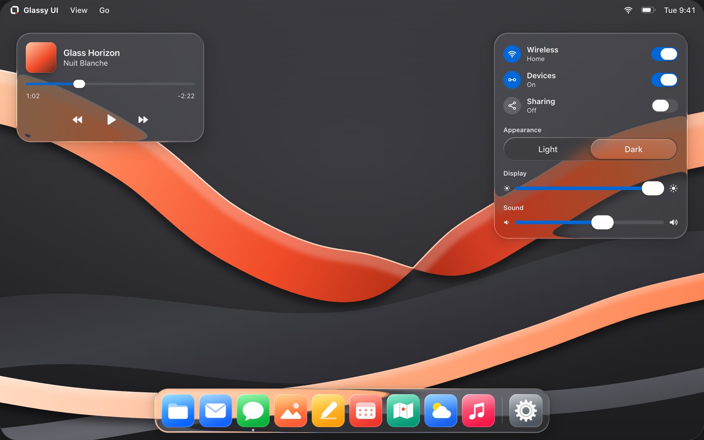

# Glassy UI

Glassy UI components for React. Install with shadcn. Own the source.

36 glass components, MIT licensed. The registry copies React source, required
styles and dependencies into your app; there is no Glassy UI runtime package.

[Website](https://glassyui.com) · [Docs](https://glassyui.com/docs) ·
[Components](https://glassyui.com/components) ·
[Templates](https://pro.glassyui.com) · [Guides](https://glassyui.com/guides) ·
[llms.txt](https://glassyui.com/llms.txt) ·
[Report an issue](https://github.com/alexburlis/glassyui/issues/new/choose)



## Start with something you can use

- [Glass Scene](https://glassyui.com/components/glass-scene): refractive
  surfaces and merging drops over an included backdrop.
- [Glass Lens](https://glassyui.com/components/glass-lens): a draggable,
  keyboard-accessible magnifier.
- [Glass Dock](https://glassyui.com/components/glass-dock): labeled icon
  controls on a glass shelf.
- [Glass Header](https://glassyui.com/components/glass-header): a floating glass
  capsule with navigation and a mobile menu.

The Scene, Lens and Dock pages show the source for their live examples. Each
example's install command includes every primitive it uses.

## Install

Start with a React 19+ and Tailwind CSS 4 app and initialize shadcn if it does
not already have a `components.json`:

```bash
pnpm dlx shadcn@4.14.1 init
```

Add the Glassy UI namespace:

```json
{
  "registries": {
    "@glassyui": "https://glassyui.com/r/{name}.json"
  }
}
```

Then install only the component you need:

```bash
pnpm dlx shadcn@4.14.1 add @glassyui/glass-button
```

Namespaced registry dependencies are resolved transitively. The installed
provider module imports the shared CSS, so registry consumers do not need a
separate stylesheet copy or a provider wrapper just to render a component. Use
`GlassProvider` when the app needs synchronized theme, quality, motion, or
transparency preferences.

Set `data-lg-theme="light"` on the root element for a light app, or
`data-lg-theme="dark"` for a dark app. Keep that attribute in sync with your
app's theme switch. When using `GlassProvider`, match its `defaultTheme` to the
app's initial theme.

Complete site templates built from these components are part of
[Glassy UI Pro](https://pro.glassyui.com). Its application and commercial source
live in a separate private repository. This repository owns the free library,
documentation and public Pro teaser.

CSS frost works independently of the scene renderer. Glass Scene requires WebGL2
and a supplied backdrop; it does not refract arbitrary DOM. Reduced transparency
and contrast preferences disable its canvas, and reduced motion stops its flow.
See
[rendering and accessibility](https://glassyui.com/guides/glass-accessibility).

Style components with `className`. Library defaults sit in the `components`
cascade layer, so Tailwind utilities override them without `!`, while
reduced-transparency, contrast and motion preferences still win. See
[Customizing](docs/liquid-components.md#customizing).

## Expo and React Native

The `@glassyui-native` registry has React Native versions of the components for
Expo apps, with shared names and React Native props. Shared controls need SDK 55
or later; Picker, Swipe Row and Card Stack target SDK 57. iOS 26 and later draw
the system's own glass through `expo-glass-effect`; earlier iOS, Android and the
web blur what lies behind with `expo-blur`. Scene, lens, header, tooltip,
keyboard keys, breadcrumb, pagination, command menu, laptop and phone mockups
are web-only.

`shadcn init` does not set up Expo apps, so add a `components.json` with the
namespace (the [Expo guide](https://glassyui.com/guides/expo) has the whole
file), then add a component and match its packages to your SDK.

Keep an existing `@/*` TypeScript path mapping, or map it to `./*` for files at
the app root (`./src/*` for a `src` app).

```json
{
  "registries": {
    "@glassyui-native": "https://glassyui.com/r/native/{name}.json"
  }
}
```

```bash
npx shadcn@4.14.1 add @glassyui-native/glass-button
npx expo install --fix
```

Every component page with a React Native version has a React / React Native
switch for its install command and usage, and
[glassyui.com/mobile](https://glassyui.com/mobile) shows the same app screen on
iOS, Android and the web.

Android blurs only what sits inside a `GlassBackdrop`; put the content behind
your glass in its `backdrop`. The React Native source lives in
[`registry/glassyui-native`](registry/glassyui-native), and
[`fixtures/expo-consumer`](fixtures/expo-consumer) renders every component.

## Local development

Use Node 22 and the pnpm version pinned in `package.json`.

```bash
pnpm install --frozen-lockfile
pnpm dev
```

The script binds to loopback only. Visit `http://127.0.0.1:3000` for the landing
page and `http://127.0.0.1:3000/components` for component docs.

## Registry development

The editable catalog is [`registry.json`](registry.json), its source files live
in [`registry/glassyui`](registry/glassyui), and generated install payloads live
in [`public/r`](public/r).

To test unpublished changes, keep this repository running and temporarily map
the namespace to its loopback server:

```json
{
  "registries": {
    "@glassyui": "http://127.0.0.1:3000/r/{name}.json"
  }
}
```

Add an item through that namespace:

```bash
pnpm dlx shadcn@4.14.1 add @glassyui/glass-button
```

## Direct source-copy alternative

To copy source directly from this repository, start with a React 19+ and
Tailwind 4 app. The registry path above is recommended because it resolves all
required files automatically.

1. Install only the package dependencies required by the components you copy.
   The complete component set uses:

   ```bash
   pnpm add clsx cmdk \
     @radix-ui/react-accordion \
     @radix-ui/react-avatar \
     @radix-ui/react-checkbox \
     @radix-ui/react-dialog \
     @radix-ui/react-dropdown-menu \
     @radix-ui/react-popover \
     @radix-ui/react-radio-group \
     @radix-ui/react-select \
     @radix-ui/react-slider \
     @radix-ui/react-slot \
     @radix-ui/react-switch \
     @radix-ui/react-tabs \
     @radix-ui/react-toast \
     @radix-ui/react-tooltip
   ```

2. Import a copy of [`src/styles/liquid.css`](src/styles/liquid.css) once as a
   global stylesheet. It declares its own cascade layers, so do not wrap it in
   another `@layer`.
3. Copy the component files you need from
   [`src/components/liquid`](src/components/liquid), then recursively copy every
   local relative-import dependency used by those files, including provider,
   preference, and internal helper modules.
4. Mount `GlassProvider` only when the consumer needs synchronized or persisted
   preference state. Set `data-lg-theme` on the root element as described above.
5. Mount
   [`src/components/liquid/liquid-filters.tsx`](src/components/liquid/liquid-filters.tsx)
   only for legacy CSS that references `url(#lg-liquid-refraction)`. Generated
   supplied-background refraction creates its own per-surface filter.

## Repo structure

- `src/app` – Next.js App Router pages powering the docs/playground
- `src/components/liquid` – copy-ready components (Button, Input, Dialog, etc.)
- `src/components/site` and `src/components/docs` – the marketing site and docs
  shell, built from the library components
- `src/components` – development-only diagnostics (gallery, preference controls,
  debug and performance overlays)
- `src/lib/liquid` – preference persistence helpers
- `src/styles/liquid.css` – Glassy UI tokens, noise layer, specular/rim
  utilities
- `registry/glassyui-native` – the React Native (Expo) components, catalogued in
  `registry-native.json`
- `fixtures/expo-consumer` – an Expo app that renders every React Native
  component

## Scripts

### Development and formatting

- `pnpm dev` – start the docs site on `127.0.0.1`
- `pnpm build` – production build
- `pnpm start` – serve the built site on `0.0.0.0`
- `pnpm lint` – Oxlint anti-slop rules and ESLint with Next.js core web vitals
  rules
- `pnpm format:check <changed-files>` – check touched files with the pinned
  repository formatter

### Registry and consumer installs

- `pnpm check:registry` – verify registry metadata, source files, targets,
  dependencies, and blocked imports
- `pnpm registry:build` – regenerate the static item payloads in `public/r`
- `pnpm registry:check-generated` – compare generated registry output with
  `public/r`
- `pnpm smoke:registry-routes` – check `/r/registry.json` and
  `/r/glass-button.json` against a running local server
- `pnpm check:native-registry` – verify the Expo catalogue's import closures,
  declared packages and `public/r/native` payloads
- `pnpm smoke:expo-consumer http://127.0.0.1:3100` – install every Expo item
  into a clean copy of the Expo fixture, then type-check and bundle it for iOS,
  Android and the web
- `pnpm smoke:registry-install http://127.0.0.1:3100` – install a transitive
  item into a clean temporary consumer from a running local production server

### Browser and release checks

- `pnpm smoke:docs-routes` – check the landing, component index, and component
  docs routes against a running local server
- `pnpm smoke:release-ui http://127.0.0.1:3100` – exercise every public demo
  across the release viewport and preference matrix
- `node scripts/smoke-header.mjs http://127.0.0.1:3100 .artifacts/header` –
  verify the header across sizes, themes and browsers, with screenshots
- `pnpm smoke:launch http://127.0.0.1:3100 .artifacts/prelaunch/launch` – verify
  demo copying, guides, share cards and the retired template redirects in Chrome
- `node scripts/capture-launch-previews.mjs http://127.0.0.1:3000` – refresh the
  three launch screenshots and the desk this README opens with
- `node scripts/capture-share-cards.mjs http://127.0.0.1:3000 [card ...]` –
  photograph every page's link-preview card into `public/share`; the home and
  React Native loops are rendered by `link-previews/` (`public/share/README.md`)
- `pnpm check:refraction-visuals http://127.0.0.1:3100` – capture deterministic
  active/plain refraction evidence, enforce edge-focused distortion in Chromium,
  Firefox and WebKit, read every frame of a Chromium scroll to prove the
  GlassSurface docs' fixed-wallpaper example never trails its wallpaper, and
  prove the home page's WebGL pane bends the wallpaper pinned behind it in all
  three engines
- `pnpm check:glass-material http://127.0.0.1:3100` – prove every frosted
  component blurs a striped backdrop in Chromium, the lens activates, WebKit and
  Firefox keep the CSS frost, floating text keeps 4.5:1 contrast, and Reduce
  Transparency beats a consumer tint
- `pnpm check:glass-scene http://127.0.0.1:3100` – prove in Chromium, WebKit and
  Firefox that `GlassScene` draws glass that lines up with the DOM, bends the
  backdrop at the rim, merges nearby glass, ignores where the pointer is and
  steps aside for accessibility settings and a missing or lost WebGL2 context,
  and that the controls' liquid motion stretches and settles

## Documentation

- [Local library boundary](docs/local-library-boundary.md)
- [Liquid components](docs/liquid-components.md)
- [Registry installation](docs/registry-installation.md)
- [Registry components](docs/registry-components.md)
- [Release verification](docs/launch-readiness.md)

## Contributing

See [CONTRIBUTING.md](CONTRIBUTING.md). The project is MIT licensed; copied
upstream code and package dependencies retain their notices in
[THIRD_PARTY_NOTICES.md](THIRD_PARTY_NOTICES.md).

## Design targets

- Specular sheen, blur, and chromatic aberration baked into CSS utilities
- Preference switches for Clear/Tinted, Reduce Transparency, Reduce Motion
- Card/gallery layout that mirrors the final component copies
